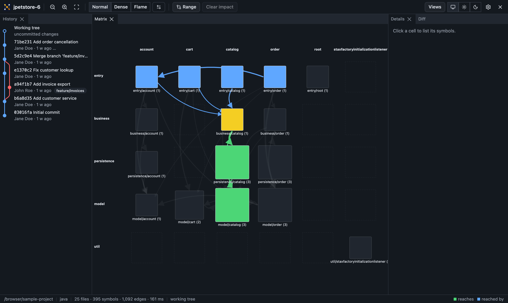
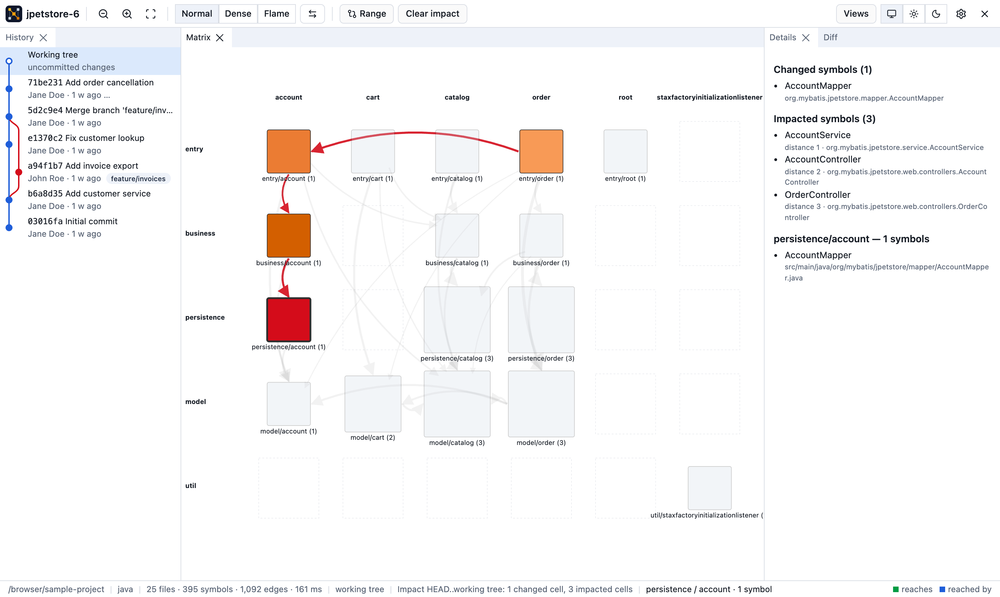
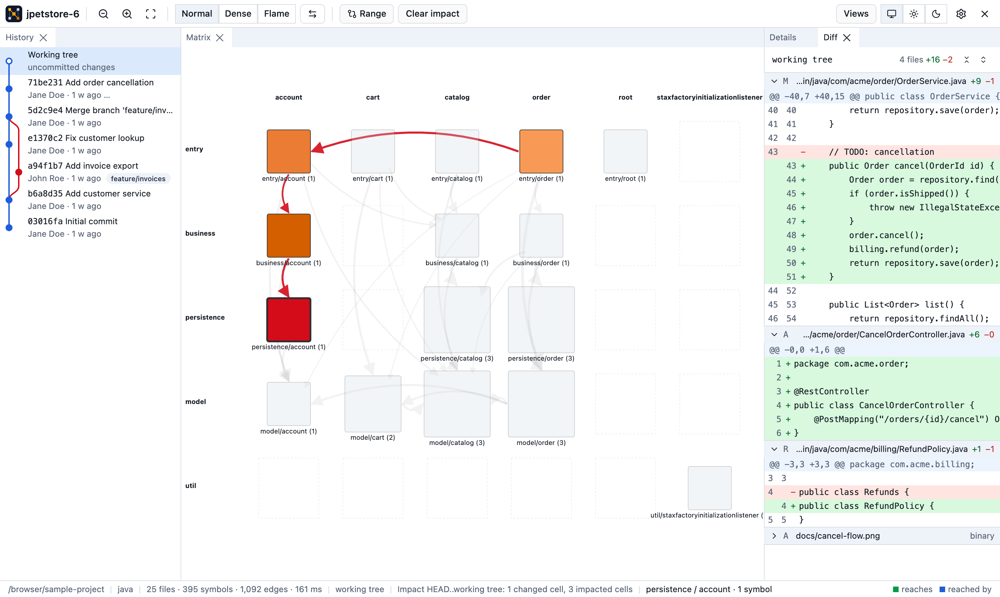
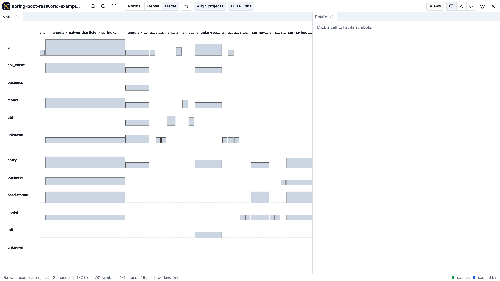
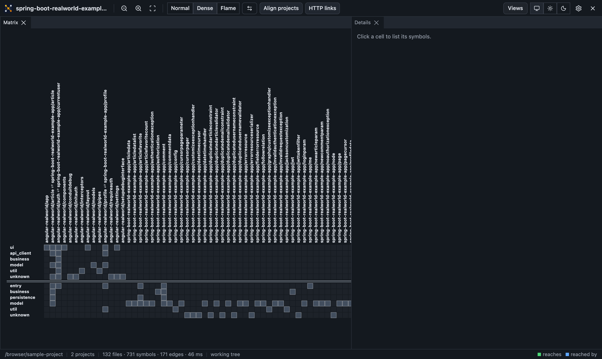
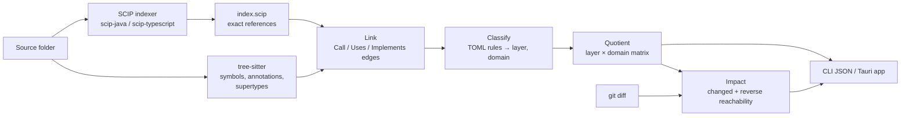

<p align="center">
  
</p>

<h1 align="center">Structure</h1>

<p align="center">
  <b>See a whole codebase as one matrix, and see what a diff really touches.</b><br>
  Structure turns a Java or TypeScript project into a call graph, folds it into
  <code>layer × domain</code> cells, and renders it as an interactive matrix.
</p>

<p align="center">
  
</p>

<p align="center"><sub>
  <a href="https://github.com/mybatis/jpetstore-6">jpetstore-6</a> in Structure. Hovering
  <code>business/catalog</code> lights up what it reaches (green) and what reaches it (blue).
</sub></p>

> **Status: proof of concept.** Local only, Java and TypeScript, class-level
> granularity. See [Limitations](#limitations).

## Why

A call graph with thousands of symbols is unreadable. Structure does not draw
it symbol by symbol. It groups every class into a cell:

- a **layer** (row): `entry`, `business`, `persistence`, `model`, `util`, plus `ui` and `api_client` for front ends;
- a **domain** (column): `account`, `order`, `catalog`, and so on, derived from packages and modules.

Edges between symbols become edges between cells. You get a picture that fits
on one screen, reads top to bottom, and answers two questions quickly:

1. **How is this software organised?** Which domains exist, which layers they span, who calls whom.
2. **What does this change impact?** Which cells a diff modifies, and which ones depend on them.

## Features

| | |
| --- | --- |
| **Layer × domain matrix** | Cells sized by symbol count, edges aggregated between cells. Zoom, pan, expand domain groups. |
| **Hover to trace** | Forward and backward traversal from any cell: what it reaches, what reaches it. |
| **Diff impact** | Changed cells in red, transitive callers shaded by distance. Works on the working tree or any `base..head`. |
| **Git history** | Pick a commit in the history panel to see its matrix and its impact. |
| **Front + back together** | Analyse an Angular front and a Spring back in one matrix; HTTP calls are matched to endpoints. GWT RPC calls are linked to their service implementations. |
| **Three views** | *Normal* (labelled cells and edges), *Dense* (uniform tiles for big projects), *Flame* (column widths by size). |
| **Compiler-accurate edges** | Tree-sitter for symbols, [SCIP](https://github.com/sourcegraph/scip) indexes for exact references. |
| **Custom rules** | Classification is plain TOML; override it per project. |
| **CLI and desktop app** | The `structure` binary emits JSON; the Tauri app is the interactive view. |

## Tour

### Impact of a change

Edit `AccountMapper.java`, pick *Working tree* in the history panel. The
changed cell turns red; its callers are shaded by distance. The details panel
lists the changed and impacted symbols.



The Diff panel shows the matching textual diff next to the matrix.



### Front and back in one matrix

Open several folders at once. Each project gets its own layer band, split by a
double line. A front domain and the back domain it calls share a column
(`angular-realworld/article ⇄ spring-boot…/article`).



### Dense view

For projects with many domains, the Dense view packs the matrix into uniform
tiles.



## Quick start

### Prerequisites

- Rust (stable) and Node 20+
- For the desktop app: `cargo install tauri-cli --version "^2"`
- For Java indexing: a JDK, plus Maven or the project's Gradle wrapper. `scip-java` or Coursier (`cs`) is optional.
- For TypeScript indexing: `npx` (the indexer is fetched and run for you)

### Run the desktop app

```sh
cd app/ui && npm install
cd ../src-tauri && cargo tauri dev
```

Click **Open project…**, choose a Java or TypeScript folder, then **Analyze**.
Add a second folder to analyse a front and a back together.

To try the UI without analysing anything, run it in a browser on sample data:

```sh
cd app/ui && npm run dev                 # jpetstore sample
# then open /?sample=matrix-multi for the front + back sample
```

### Run the CLI

```sh
cargo run -p structure-cli -- analyze <project> -o matrix.json
```

Example on jpetstore-6:

```console
$ structure analyze fixtures/jpetstore-6 -o matrix.json
[  5%] indexing
[ 35%] parsing
[ 60%] linking
[ 80%] classifying
[ 95%] building matrix
[100%] done
language: Java, files: 25, symbols: 395, edges: 1092
scip: 45 documents, 9849 occurrences
edges: 594 (call 170, uses 424)
total: 85 ms
                  account         cart      catalog        order         root staxfactoryi
entry                   1            1            1            1            1            .
business                1            .            1            1            .            .
persistence             1            .            3            3            .            .
model                   1            2            3            3            .            .
util                    .            .            .            .            .            1
```

Progress, stats and the table go to stderr. The matrix JSON goes to `-o` or
stdout. (Output shortened; timings are with an existing `index.scip`.)

More commands:

```sh
structure analyze front/ back/ -o matrix.json     # several roots, one matrix
structure analyze <project> --no-scip             # tree-sitter only, no indexer
structure analyze <project> --reindex             # rebuild index.scip
structure impact <project> -o impact.json         # working tree vs HEAD
structure impact <project> --base main --head feature
```

`impact` returns the changed cells and the cells that depend on them, with
their distance from the change:

```json
{
  "base": "HEAD",
  "head": null,
  "changed_files": ["src/main/java/org/mybatis/jpetstore/mapper/AccountMapper.java"],
  "changed_cells": ["persistence:account"],
  "impacted_cells": [
    { "id": "business:account", "distance": 1 },
    { "id": "entry:account", "distance": 2 },
    { "id": "entry:order", "distance": 3 }
  ]
}
```

Full samples are in [docs/samples/](docs/samples/).

## How it works



1. **Parse.** Tree-sitter extracts classes, ranges, annotations and supertypes.
2. **Index.** The SCIP indexer runs as a subprocess. An existing `<project>/index.scip` is reused.
3. **Link.** SCIP occurrences are joined to tree-sitter symbols to produce `Call`, `Uses` and `Implements` edges.
4. **Classify.** TOML rules assign each class a layer and a domain.
5. **Quotient.** Symbols collapse into cells; edges are aggregated between cells.
6. **Impact.** A git diff maps to changed symbols, then reverse edges give the impacted cells.

## Classification rules

Rules are TOML. The first matching rule wins; matchers inside a rule are ANDed.

```toml
[[rule]]
layer = "entry"
any_annotation = ["RestController", "Controller"]

[[rule]]
layer = "persistence"
kind = ["interface"]
name_suffix = ["Mapper"]

[[rule]]
layer = "util"
package_contains = [".config.", ".configuration."]
```

Built-in rules cover Spring, Stripes, MyBatis and JPA ([rules/java.toml](rules/java.toml))
and Angular and NestJS ([rules/typescript.toml](rules/typescript.toml)). To
override them for one project, add `<project>/.structure/rules.toml`: its rules
take priority over the built-in ones.

## Repository layout

```text
crates/
  ir/          Graph, Symbol, Edge, Matrix, Impact: the shared contracts
  lang-java/   tree-sitter front end for Java
  lang-ts/     tree-sitter front end for TypeScript
  scip/        reads index.scip, links occurrences to symbols
  classify/    rules and the quotient matrix
  git/         diff → changed and impacted cells
  core/        facade and pipeline (analyze, indexers, snapshots, history)
  cli/         the `structure` binary
app/
  src-tauri/   Tauri 2 commands over the pipeline
  ui/          Vite + Svelte 5 + TypeScript
rules/         built-in classification rules
docs/          plan, Tauri API contract, sample JSON
scripts/       fetch and index the demo fixtures
tests/golden/  expected classifications
```

More detail: [docs/plan.md](docs/plan.md) (POC plan, in French),
[docs/api.md](docs/api.md) (UI ↔ Rust contract), [app/README.md](app/README.md) (desktop app).

## Development

```sh
cargo check --workspace
cargo fmt --check
cargo clippy --workspace --all-targets -- -D warnings
cargo test --workspace
cd app/ui && npm test && npm run check
```

End-to-end tests use demo projects in `fixtures/` (git-ignored):

```sh
scripts/fetch-fixtures.sh     # clone jpetstore-6, angular-realworld, spring-boot-realworld
scripts/index-fixtures.sh     # write fixtures/*/index.scip
STRUCTURE_FIXTURES=$PWD/fixtures cargo test
```

Tests skip a fixture that is missing or has no `index.scip`; they never run an
indexer. See [scripts/README.md](scripts/README.md).

## Limitations

- **Class-level granularity.** Classification is heuristic and driven by the rules.
- **Without `index.scip`** (or if indexing fails), only tree-sitter edges are used, so call edges are far fewer.
- **Impact follows reverse edges only.** No dynamic dispatch, reflection or DI wiring beyond what SCIP sees.
- **Language detection** uses `pom.xml` / `build.gradle*` (Java) or `tsconfig.json` / `package.json` (TypeScript). One language per root.
- **First indexing can take minutes** (Maven build, `npm install`).
- **scip-java runs the project's Maven build.** A `~/.m2/settings.xml` that points to an unreachable private repository makes it hang; the app gives up after 10 minutes and falls back to tree-sitter.
- **Gradle projects** are indexed through their own wrapper, which must support the JDK in use.
- **Kotlin sources are ignored**; generated sources under `build/` are not modelled.
